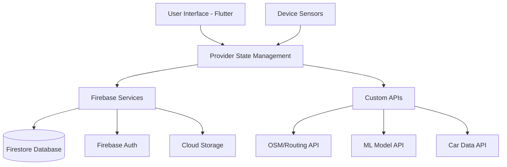

# DriveSafe - VES Technothon Final Project

[](https://github.com/dakshgopani/Drive-Safe/commits/main)
[](https://github.com/dakshgopani/Drive-Safe/issues)

A smartphone application for **real-time driving behavior analysis and feedback**, built using Flutter and AI/ML tools to promote safer driving habits.

> Award: **Winner - Problem Statement Track (PS) 03** at VES Technothon

---

## Overview

**DriveSafe** transforms any smartphone into a smart co-driver. It passively monitors driving behavior using built-in sensors (accelerometer, gyroscope, GPS) and uses AI to deliver live insights, training, and rewards for safer driving — without needing costly vehicle modifications.

### The Problem

Traditional methods of assessing driving behavior for insurance purposes often involve costly hardware installations or are limited by data points. In India, where multiple individuals might drive the same vehicle, accurately assessing driving behavior can be challenging.

### Our Solution

A smartphone-based solution that provides comprehensive driving analytics, insurance integration, gamification, and rewards—all in one app.

---

## Key Features

- **Real-time Eco & Safety Scoring** – Continuous analysis of driving patterns with accurate scoring
- **Turn-by-turn Navigation** – Powered by OpenStreetMap and OSRM routing
- **Insurance Integration** – Policy suggestions and purchases based on driving score
- **Gamification & Leaderboards** – Compete with friends & family
- **Convoy Mode** – Family trip tracking with group monitoring
- **Virtual Driving School** – Interactive training courses and quizzes
- **Driver Alertness Monitoring** – Camera-based drowsiness detection
- **Rewards System** – Scratch cards and in-app store for redeeming rewards
- **Emergency Kit Access** – Quick access to roadside assistance features

---

## Technology Stack

| Layer | Technology |
|-------|------------|
| **Frontend** | Flutter 3.x (cross-platform mobile UI) |
| **Language** | Dart 3.x |
| **State Management** | Provider Pattern |
| **Backend** | Firebase (Firestore, Authentication, Storage) |
| **Maps & Navigation** | OpenStreetMap (OSRM), flutter_osm_plugin |
| **AI/ML** | Google ML Kit, Hugging Face hosted models |
| **Sensors** | sensors_plus, geolocator, permission_handler |
| **Payments** | Razorpay API |
| **Additional Libraries** | fl_chart, confetti, shared_preferences, image_picker |

---

## Architecture



---

## Getting Started

### Prerequisites

- Flutter 3.x SDK
- Dart SDK 2.19+ (requires Dart 3.5.3+)
- Firebase CLI
- Android Studio / VS Code with Flutter extensions

### Installation

```bash
# Clone the repository
git clone https://github.com/dakshgopani/Drive-Safe.git
cd Drive-Safe

# Install Flutter dependencies
flutter pub get

# Configure Firebase
# Android: Place google-services.json in android/app/
# iOS: Place GoogleService-Info.plist in ios/Runner/
```

### Running the App

```bash
# Run on connected device or emulator
flutter run

# Run on specific platform
flutter run -d android   # Android
flutter run -d ios       # iOS
flutter run -d web       # Web

# Build APK (Android)
flutter build apk --release

# Build iOS
flutter build ios --release
```

---

## Configuration

### Firebase Setup

Required Firebase services:

| Service | Purpose |
|---------|---------|
| Authentication | User sign-in (Email/Google) |
| Firestore | User data, trips, scores |
| Storage | Image assets |
| Cloud Messaging | Notifications |

### API Keys Required

The app integrates with several external APIs:

| API | Purpose | Header |
|-----|---------|--------|
| RapidAPI (Google Maps) | Search & Place Details | `x-rapidapi-key` |
| OSRM | Route calculation | N/A (public) |
| Car Data API | Vehicle information | `x-rapidapi-key` |

The Firebase configuration is generated automatically in `lib/firebase_options.dart` during setup.

### Environment Configuration

Configure the following in `firebase_options.dart`:

```dart
static const FirebaseOptions android = FirebaseOptions(
  apiKey: 'your-api-key',
  appId: 'your-app-id',
  messagingSenderId: 'your-sender-id',
  projectId: 'algo-avengers-ves-final',
  storageBucket: 'algo-avengers-ves-final.firebasestorage.app',
);
```

---

## Usage

### User Flow

1. **Welcome Screen** → **Login/Register**
2. **Map Screen** (main dashboard)
3. **Navigation** → **Destination Search**
4. **Start Trip** → Real-time monitoring
5. **Trip Results** → Eco/Safety scores
6. **Rewards** → Scratch card & store redemption

### Sample Navigation

```dart
// Navigate from login to home
Navigator.pushNamed(context, '/home', arguments: {
  'userId': user.uid,
  'userName': user.displayName ?? 'User',
  'email': user.email ?? '',
});
```

### Starting a Trip Recording

```dart
// Import the driving service
import '../services/driving_service.dart';

// Start driving behavior analysis
DrivingBehaviorService service = DrivingBehaviorService();
service.startTracking();

// The service listens to:
// - Accelerometer events
// - Gyroscope events
// - GPS position updates
```

---

## Project Structure

```
lib/
├── api/                    # External API services
│   └── apis.dart           # Google Maps, Car Data APIs
├── models/               # Data models
│   ├── chat_user.dart
│   ├── distance_bottom_sheet.dart
│   └── user_profile.dart
├── routes/                 # Navigation routes
│   ├── app_routes.dart
│   └── route_generator.dart
├── screens/                # UI screens
│   ├── auth/               # Login, Signup
│   ├── convoyMode/         # Family trip tracking
│   ├── drawer/             # Main menu screens
│   ├── initial/            # Splash, Welcome, Onboarding
│   ├── home_screen.dart
│   └── map_screen.dart     # Main map interface
├── services/               # Business logic
│   ├── driving_service.dart
│   ├── trip_service.dart
│   ├── firebase_service.dart
│   └── crash_detection_api.dart
├── theme/                   # App theming
│   ├── app_theme.dart
│   ├── colors.dart
│   └── text_styles.dart
├── utils/                   # Utilities and helpers
├── widgets/                 # Reusable UI components
└── main.dart                # App entry point
```

---

## Testing

```bash
# Run unit tests
flutter test

# Run with coverage
flutter test --coverage

# Run integration tests
flutter drive --target=test_driver/app.dart

# Analyze code
flutter analyze
```

---

## Contributing

We welcome contributions! Please follow these steps:

1. Fork the repository
2. Create a feature branch (`git checkout -b feature/amazing-feature`)
3. Commit your changes (`git commit -m 'Add amazing feature'`)
4. Push to the branch (`git push origin feature/amazing-feature`)
5. Open a Pull Request

### Development Setup

```bash
# Get dependencies
flutter pub get

# Run format
flutter format .

# Run lint fixes
dart fix --apply
```

---

## License

This project is licensed under the MIT License.

---

## Team

| Name | LinkedIn |
|------|----------|
| Kankshi Shah | [LinkedIn](https://www.linkedin.com/in/kankshi-shah-76539a258/) |
| Daksh Gopani | [LinkedIn](https://www.linkedin.com/in/daksh-gopani-a13993251/) |
| Rudra Parmar | [LinkedIn](https://www.linkedin.com/in/rudra-parmar-089125245/) |
| Samyak Chheda | [LinkedIn](https://www.linkedin.com/in/samyakchheda/) |


---

## Demo

View the web application:
[DriveSafe Web App](https://drivesafe-alpha.vercel.app/)

---

## Future Roadmap

- **Advanced ML Features** – Real-time drowsiness detection with early warnings
- **Smart Device Integration** – Wearable connectivity for health metrics
- **Eco-Driving** – EV optimization and carbon-offset rewards
- **IoT Integration** – V2V communication and smart city infrastructure
- **Insurance Claims** – AI-powered automated claims processing

---

## Known Limitations

- Navigation requires internet connection for map tiles
- Driving analysis requires manual start/stop via button
- Rewards system dependent on Firebase connectivity
- Crash detection uses local heuristics, not clinical-grade sensors
